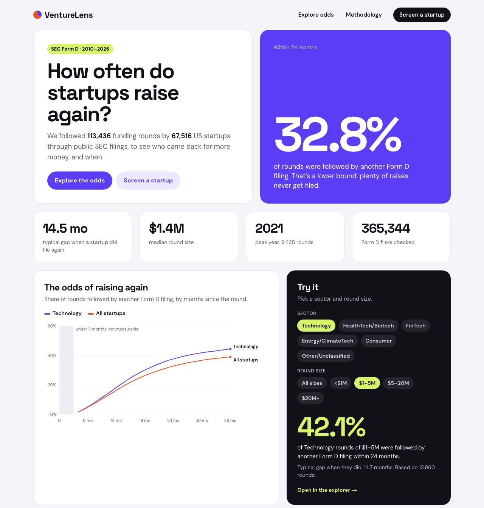
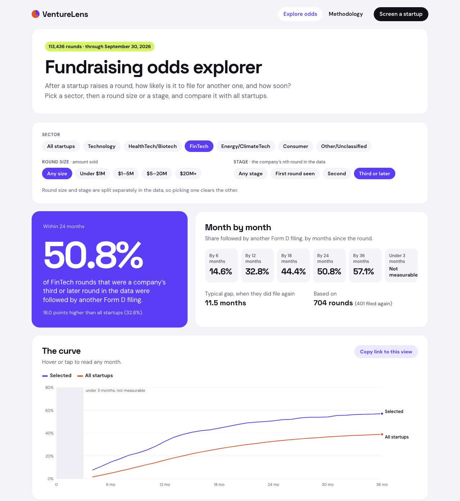

# VentureLens

**How often do US startups raise again, and how soon? Fundraising benchmarks built from 365,344 SEC Form D filers, plus a screening calculator that puts any startup's runway next to them.**

🔗 **Live site:** https://venturelens-chi.vercel.app



---

## What the data shows

Across **113,436 funding rounds by 67,516 US startups (2010–2026)**, from public SEC Form D filings:

- **About a third of rounds (32.8%) are followed by another Form D filing within 24 months.** That's a lower bound: many raises are never filed on Form D.
- **When a startup does file again, it's about 14.5 months later**, and that gap is close to 14 months in every sector.
- **Mid-size rounds lead.** $1–5M Technology rounds filed again 42.1% of the time within two years, against 33.7% for rounds under $1M and 35.7% for $20M or more.
- **Momentum is visible.** Companies on their third or later round in the data file again roughly half the time within 24 months; first rounds seen do so 17–32% of the time, depending on sector.
- **The 2021 boom shows up clearly:** 9,425 rounds in 2021, 6,429 in 2025 (32% fewer). The median round is $1.4M.

Paid databases like PitchBook sell this kind of benchmark. VentureLens builds it from free public filings, and shows its work. Full write-up: [pipeline/FINDINGS.md](pipeline/FINDINGS.md).

## The site

| Page | What it does |
|---|---|
| **[Home](https://venturelens-chi.vercel.app)** | The story in numbers: the odds curve, a sector and round-size picker, key findings written from the data, rounds per year, and the cleaning funnel |
| **[Explore odds](https://venturelens-chi.vercel.app/explore)** | Pick a sector, then a round size or a stage, and see the chance of another filing by month 6, 12, 18, 24 and 36 against all startups. Every view is a shareable link |
| **[Methodology](https://venturelens-chi.vercel.app/methodology)** | How filings become rounds, how “raising again” is measured, the validation check, and the limitations, in plain English |
| **[Screen a startup](https://venturelens-chi.vercel.app/screen)** | A calculator for one startup: runway, ownership, MOIC, IRR, Bear/Base/Bull cases, risk flags, and how often comparable rounds raised again within its runway. Save companies to compare them or write a printable memo |



## How the data is built

A Python pipeline (`pipeline/`) turns the SEC's quarterly Form D data sets into funding rounds:

1. **Download** every quarterly data set the SEC has published (`download.py`).
2. **Clean** (`build_dataset.py`): drop investment funds and non-US companies; fold amendments into the original filing; merge filings within 90 days into one round; keep companies under about five years old at their first round seen (2010 on) in venture-type industries; drop buyout, SPAC and fund vehicles, established businesses, and a hand-reviewed list of implausible filings.
3. **Measure** (`analyze.py`): Kaplan–Meier estimates of the share of rounds followed by another filing, month by month. Recent rounds count only for the months they've been watched.
4. **Summarize** (`summarize.py`): headline counts and medians for the site. No dollar totals, because a few self-reported amounts (one filing claims $48 billion from a single investor) would dominate any sum.

The funnel runs from **365,344 filers to 67,516 startups**. Every rule, and where it can be wrong, is in [pipeline/DECISIONS.md](pipeline/DECISIONS.md).

**Validation.** For 10 well-known startups (Ramp, Databricks, Figma, Instacart, Warby Parker, Peloton, Airbnb, Lemonade, Rippling, Plaid), **59 of 82** publicly reported rounds appear in the data. Some companies file every round (Ramp 11 of 11); others stop (Plaid 1 of 6). That matches research finding that most venture-backed rounds have no Form D, and it's why every rate here is a lower bound.

## The screening calculator

- Runway = cash ÷ (annual burn ÷ 12)
- Ownership = investment ÷ post-money, then reduced by expected future dilution
- Exit value = current revenue × (1 + growth)^years × exit revenue multiple
- MOIC = investor exit proceeds ÷ investment; IRR = MOIC^(1/years) − 1

**Scenarios.** Base uses your inputs. Bear halves growth, lowers the exit multiple by 2x, and adds 10 points of dilution. Bull raises growth 25%, adds 2x to the multiple, and cuts dilution by 5 points.

**Risk flags.**

| Metric | Positive | Neutral | Caution |
|---|---|---|---|
| Revenue growth | ≥ 50% | 20–50% | < 20% |
| Runway | ≥ 18 months | 12–18 months | < 12 months |
| Gross margin | ≥ 70% | 50–70% | < 50% |
| Largest customer share | < 15% | 15–30% | ≥ 30% |
| Bull–bear IRR spread | < 25 pts | 25–50 pts | ≥ 50 pts |

**Form D benchmark.** The startup's sector and check size pick comparable rounds, and its runway picks the month to read. For example: of 949 comparable FinTech $1–5M rounds, 23% were followed by another filing within 16 months.

**Historical cases.** Flags become risk tags (e.g. `runway-risk`, `high-burn`); a company is matched to a sourced failure case (WeWork, Bird, Fast, Airlift, Theranos) when they share at least two tags, with the similarities, differences and diligence questions.

The 10 demo companies load automatically on a first visit and are **simulated**, because private startups' financials aren't public.


## Limitations

- **A lower bound, not a success rate.** No later filing can mean an unfiled raise, an acquisition, an IPO or a shutdown.
- **A pattern, not a cause.** Companies on later rounds file again more often; that describes who keeps filing.
- **Under 3 months isn't measurable**, because filings within 90 days are merged into one round.
- **“Startup” is a rule, not a fact.** Some real startups fail the rules (one files as “…Holdco”) and some non-startups pass them.
- **A company is an SEC ID, not a brand.** Instacart files as Maplebear Inc.; a change of legal form gives a new ID.
- **The calculator is a first pass:** growth compounds at a constant rate, thresholds aren't sector-specific, and the case library has 5 cases.
- **Saved companies stay in your browser.** Nothing is shared between visitors or devices.

## Tech stack

Python (pandas, lifelines, pytest) for the data pipeline · Next.js 16, React 19, TypeScript and Tailwind CSS 4 for the site · hand-drawn SVG charts · Vitest · Vercel. Every page is prebuilt from two generated JSON files, so it loads instantly and no number is typed in by hand.

## Run locally

**The website:**

```bash
git clone https://github.com/mwhan99/venturelens.git
cd venturelens
npm install
npm run dev
```

Open http://localhost:3000. Run the tests with `npm test`.

**The data pipeline** (Python 3.11 or newer; the raw data is about 1.2 GB once unzipped):

```bash
python3 -m venv pipeline/.venv
source pipeline/.venv/bin/activate
pip install -r pipeline/requirements-dev.txt
export SEC_USER_AGENT="Your Name you@example.com"
python pipeline/download.py
python pipeline/build_dataset.py
python pipeline/analyze.py
python pipeline/summarize.py
python -m pytest pipeline/tests
```

Details are in [pipeline/README.md](pipeline/README.md).

## Roadmap

- **Company lookup:** search any of the 166,601 Form D filers and see its rounds, and why it is or isn't in the benchmark
- **Quarterly refresh:** a scheduled job that rebuilds the data when the SEC posts a new quarter
- Sector-specific risk thresholds, and a growth-decay model instead of constant compounding

---

Built by **Avery Han**, M.S. Management and Analytics, NYU.
